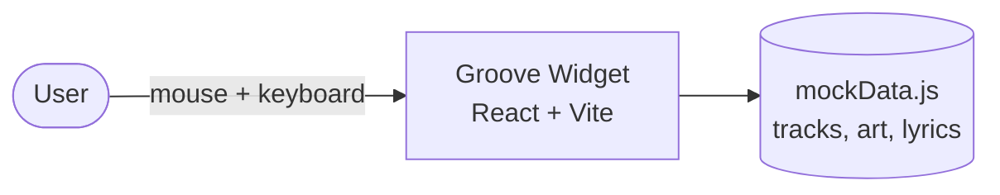
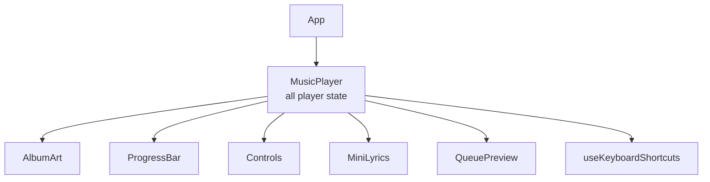

# Groove Widget: High-Level Design

A UI/UX redesign of a music-player mini widget (Spotify-style) with glassmorphism, mini lyrics, a queue preview and keyboard shortcuts. Playback is simulated with mock tracks to demonstrate the interface. Live at [groove-widget.vercel.app](https://groove-widget.vercel.app). For code-level detail see the [Low-Level Design](lld.md).

## 1. Context

## 2. Components

| Component | Responsibility |
|---|---|
| `MusicPlayer` | Track, play state, time, volume, mute, shuffle, repeat, like, lyrics and queue panels |
| `AlbumArt` | Cover image with loading state; background uses the track's dominant color |
| `ProgressBar` | Seek by click / drag, arrow keys when focused, buffered indicator |
| `Controls` | Play / pause, previous / next, shuffle, repeat, volume, like |
| `MiniLyrics` | Lyric lines synced to the simulated time |
| `QueuePreview` | Upcoming tracks |

## 3. Tech

| Item | Choice |
|---|---|
| UI | React + Vite |
| Data | Local mock tracks (title, artist, album, duration, art URL, color, lyrics) |
| Hosting | Vercel |
