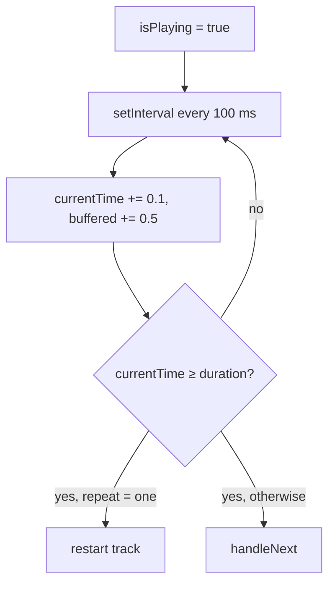

# Groove Widget: Low-Level Design

For the big picture see the [High-Level Design](hld.md).

## 1. Player state (`MusicPlayer`)

| State | Default |
|---|---|
| `currentTrack`, `queue` | First mock track, all mock tracks |
| `isPlaying` | `false` |
| `currentTime`, `buffered` | 0 |
| `volume`, `isMuted` | 0.7, `false` |
| `shuffle` | `false` |
| `repeat` | `off` (→ `all` → `one`) |
| `isLiked` | `false` |
| `showLyrics`, `showQueue` | `true`, `false` |

## 2. Simulated playback

| Handler | Rule |
|---|---|
| `handleNext` | Random track when shuffle is on, else the next one in the queue |
| `handlePrev` | Restarts the track if more than 3 s in, else previous track |
| `handleSeekForward` / `Backward` | ± 10 s, clamped |
| Volume up / down | Steps the volume, clamped 0–1 |

## 3. Keyboard shortcuts (`useKeyboardShortcuts`)

| Key | Action |
|---|---|
| Space | Play / pause |
| → / ← | Seek ± 10 s; with Ctrl / ⌘: next / previous track |
| ↑ / ↓ | Volume up / down |
| M | Mute |
| L | Toggle lyrics |
| Q | Toggle queue |
| S | Shuffle |
| R | Cycle repeat |
| N / P | Next / previous track |
